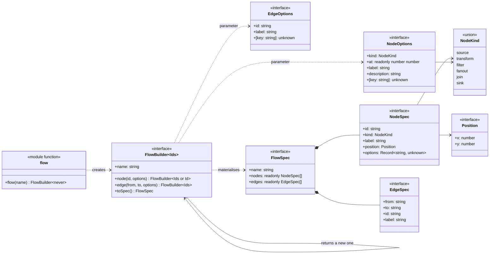
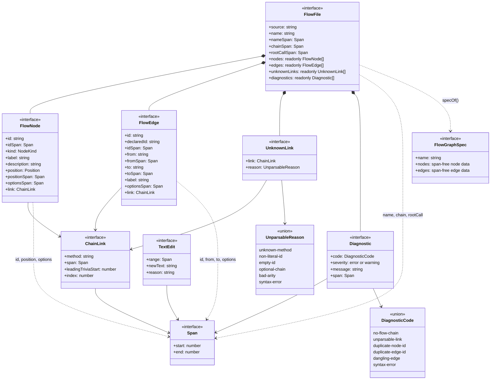
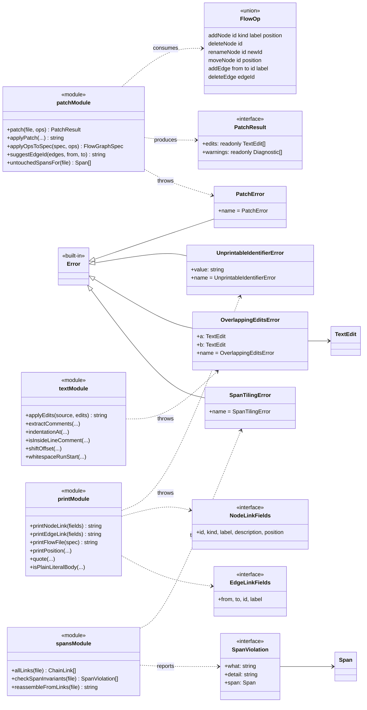
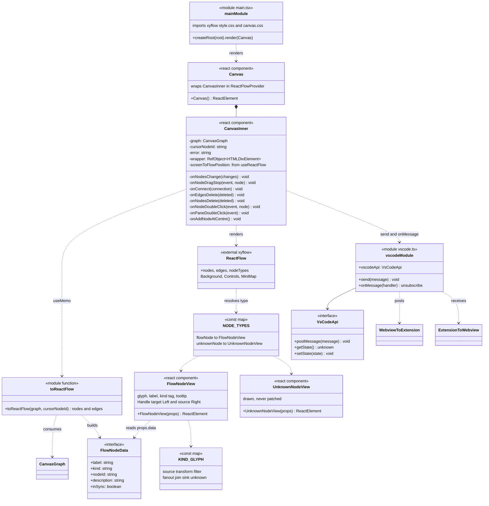
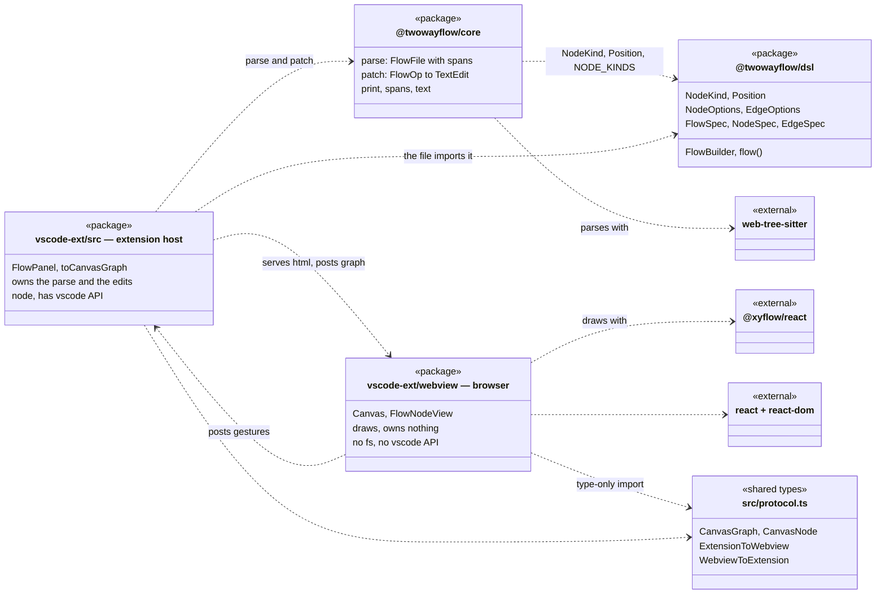

# twowayflow — UML class diagram

```
┌─────────────────────────────────────────────────────────────────────────────────────────────┐
│ Name         uml-class-diagram                                                              │
│ Type         UML class diagram — static structure, extracted from source                    │
│ Project      twowayflow                                                                     │
│ Description  The declared types of all three packages and the relationships between them:   │
│              the DSL builder that defines the file format, the span-carrying parse model in │
│              core, the extension class that holds one canvas per document, and the React    │
│              webview that draws it. Extracted from packages/*/src and                        │
│              packages/vscode-ext/webview at commit 0742448.                                  │
└─────────────────────────────────────────────────────────────────────────────────────────────┘
```

## Read this first: what "class" means in this codebase

This is a deliberately class-light TypeScript codebase. A faithful extraction finds **five
classes**, four of which are `Error` subclasses:

| Class | File | Role |
|---|---|---|
| `FlowPanel` | [panel.ts:42](../../packages/vscode-ext/src/panel.ts#L42) | the only real stateful object: one per open document |
| `PatchError` | [patch.ts:46](../../packages/core/src/patch.ts#L46) | patch refused |
| `UnprintableIdentifierError` | [print.ts:25](../../packages/core/src/print.ts#L25) | id/label cannot round-trip |
| `OverlappingEditsError` | [text.ts:3](../../packages/core/src/text.ts#L3) | two edits claim the same range |
| `SpanTilingError` | [spans.ts:13](../../packages/core/src/spans.ts#L13) | span invariant violated |

Everything else is a `readonly` **interface**, a **discriminated union**, or a free **function** —
including the webview, whose four React components are function components, not classes.
So the diagrams below use UML stereotypes — `«interface»`, `«union»`, `«module»` — rather than
pretending the types are classes. That is not a limitation of the extraction; it is the design,
and it follows from the one architectural rule: there is no persisted design model to own
behaviour, only immutable projections over text.

## 1. `@twowayflow/dsl` — the file format



Two relationships carry the design:

- **`FlowBuilder --> FlowBuilder`** is a self-association, not inheritance. Every `.node()` and
  `.edge()` returns a *new* builder, so a `.flow.ts` file is one expression with no mutation.
- The **`Ids` type parameter** accumulates declared node ids as a string-literal union, so
  `.edge()` can only name a node that already exists. A dangling edge is a compile error, not a
  runtime check. Nothing in the diagram enforces this — the type system does.

## 2. `@twowayflow/core` — the parse model

Every type here carries a `Span`. That is the whole point: the canvas is a projection, so each
projected thing must know the byte range it came from.



`FlowEdgeDraft` is `Omit<FlowEdge, "id">` — the edge as the parser reads it, before `edgeIds()`
resolves identity across the file. It is a type alias, so it has no box of its own.

## 3. `@twowayflow/core` — the patch API and its errors



The four error classes are the only inheritance in the repository, and each one marks a boundary
where the architectural rule could be broken: a patch that cannot be expressed as ranged edits
(`PatchError`), an identifier that cannot survive a round-trip
(`UnprintableIdentifierError`), two edits fighting over one range (`OverlappingEditsError`), and a
parse whose spans no longer tile the source (`SpanTilingError`).

## 4. `packages/vscode-ext` — the one stateful class

```mermaid
classDiagram
    direction TB

    class FlowPanel {
        -static byDocument: Map~string, FlowPanel~
        -file: FlowFile
        -revision: number
        -reparseTimer: Timeout
        -applyingOwnEdit: boolean
        -disposables: Disposable[]
        -panel: WebviewPanel
        -document: TextDocument
        -parser: Parser
        -extensionUri: Uri
        +static open(document, extensionUri) Promise~FlowPanel~
        -constructor(panel, document, parser, extensionUri)
        -dispose() void
        -scheduleReparse() void
        -reparse() void
        -post(message) void
        -onMessage(message) Promise
        -applyOps(ops) Promise
        -freshNodeId() string
        -toRange(span) Range
        -revealInEditor(nodeId) void
        -revealFromCursor(position) void
        -html() string
    }
    class extensionModule {
        <<module>>
        +activate(context) void
        +deactivate() void
    }
    class graphModule {
        <<module>>
        +toCanvasGraph(file, revision) CanvasGraph
    }
    class CanvasGraph {
        <<interface>>
        +name: string
        +nodes: readonly CanvasNode[]
        +edges: readonly CanvasEdge[]
        +unknown: readonly CanvasUnknown[]
        +diagnostics: readonly Diagnostic[]
        +revision: number
    }
    class CanvasNode {
        <<interface>>
        +id: string
        +kind: string
        +label: string
        +description: string
        +position: x y
        +span: Span
        +hasExplicitPosition: boolean
    }
    class CanvasEdge {
        <<interface>>
        +id: string
        +from: string
        +to: string
        +label: string
        +span: Span
    }
    class CanvasUnknown {
        <<interface>>
        +id: string
        +text: string
        +reason: string
        +span: Span
    }
    class ExtensionToWebview {
        <<union>>
        graph graph
        reveal nodeId
        error message
    }
    class WebviewToExtension {
        <<union>>
        ready
        selectNode nodeId
        moveNode nodeId position
        renameNode nodeId newId
        deleteNode nodeId
        addNode position
        addEdge from to
        deleteEdge edgeId
    }

    extensionModule ..> FlowPanel : open()
    FlowPanel "1" --> "1" FlowFile : holds the current parse
    FlowPanel ..> graphModule : projects
    FlowPanel ..> ExtensionToWebview : posts
    FlowPanel ..> WebviewToExtension : receives
    FlowPanel ..> FlowOp : emits on gesture
    graphModule ..> CanvasGraph : produces
    CanvasGraph *-- CanvasNode
    CanvasGraph *-- CanvasEdge
    CanvasGraph *-- CanvasUnknown
    CanvasGraph *-- Diagnostic
    CanvasNode --> Span
    CanvasEdge --> Span
    CanvasUnknown --> Span
```



`FlowPanel.byDocument` is a private static registry keyed by document URI — a multiton, so a
second **Open Flow Canvas** on the same file reveals the existing panel instead of creating a
rival projection. `applyingOwnEdit` is the echo guard that keeps the two directions from looping.

## 5. `packages/vscode-ext/webview` — the React layer

Across the postMessage boundary the architectural rule has to hold a second time, in a library
whose whole idiom is local state. `@xyflow/react` expects to own its nodes; here it is not
allowed to.



### The state that is deliberately missing

`CanvasInner` holds exactly three pieces of state — `graph`, `cursorNodeId`, `error` — and
**none of them is a node or an edge**. The `nodes`/`edges` handed to `<ReactFlow>` are a
`useMemo` over `toReactFlow(graph, cursorNodeId)`, recomputed only when a new parse arrives.

`onNodesChange` is where a conventional xyflow app would call `applyNodeChanges` and store the
result. This one ignores every change except `select`, which it forwards as a message. A dragged
node therefore snaps back to its parsed position and only moves once the file has been patched,
re-parsed and re-sent. That round trip is the architectural rule enforced inside React: the
canvas has no model, so there is no second model to diverge. `_addEdge` is re-exported from
xyflow at the bottom of the file but never called, for the same reason.

### Gesture → message → op

Each user gesture is one `WebviewToExtension` message; `FlowPanel.onMessage` turns it into one
`FlowOp`. Nothing in the webview edits text, and nothing in the extension draws.

| Gesture in the canvas | `CanvasInner` handler | Message sent | `FlowOp` built by `FlowPanel` |
|---|---|---|---|
| Drag a node, release | `onNodeDragStop` | `moveNode` | `moveNode` |
| Click a node | `onNodesChange` (select only) | `selectNode` | *none* — reveals in editor |
| Drag handle to handle | `onConnect` | `addEdge` | `addEdge`, id from `suggestEdgeId` |
| Delete key on a node | `onNodesDelete` | `deleteNode` | `deleteNode` |
| Delete key on an edge | `onEdgesDelete` | `deleteEdge` | `deleteEdge` |
| Double-click a node | `onNodeDoubleClick` | `renameNode` | `renameNode` |
| Double-click the pane | `onPaneDoubleClick` | `addNode` | `addNode`, id from `freshNodeId` |
| **+ Add node** button | `onAddNodeAtCentre` | `addNode` | `addNode`, id from `freshNodeId` |
| Webview finishes loading | `useEffect` | `ready` | *none* — triggers first parse |

An unparsable link is drawn as a `UnknownNodeView`, and reaching it is blocked twice over.
Every handler that receives a *node* checks `node.id.startsWith("unknown:")` and bails —
`onNodeDragStop` and `onNodeDoubleClick` return early, `onNodesDelete` skips, `onNodesChange`
reports the selection as `undefined`. The two handlers that do **not** check are `onConnect` and
`onEdgesDelete`, and neither needs to: `toReactFlow` gives unknown nodes `connectable: false`, so
no connection can start or end on one, and an edge is never unknown in the first place. The
result either way is that no gesture can produce an op against source twowayflow admitted it
could not read.

`FlowNodeView` reads `description` but nothing ever writes one: it renders as a sibling
`role="tooltip"` span wired up with `aria-describedby`, rather than a native `title`, so it can
wrap prose and follow the editor theme. `inSync` is the cursor-follows-canvas highlight — set by
`toReactFlow` when the node's id equals `cursorNodeId` from the last `reveal` message.

## 6. Cross-package dependency



The webview and the extension host are **separate runtimes** — different globals, no shared
memory, a `postMessage` channel between them. The only thing they share is `src/protocol.ts`,
imported `type`-only from the webview side, so the contract is compile-time and nothing of the
extension's code crosses into the browser. The arrow that does *not* exist is the important one:
the webview has no path to `@twowayflow/core`, so it cannot parse or patch even by accident.

The dependency only ever points one way, and `core` takes three names from `dsl`: `NodeKind` and
`Position` as `import type` in `model.ts`, `print.ts` and `patch.ts`, plus `NODE_KINDS` as a real
runtime import in `parse.ts` — the parser validates a `kind:` against the DSL's own vocabulary
rather than keeping a second copy of the list. That one value import is the only code that
crosses the boundary; everything else erases at compile time. The DSL knows nothing about
parsing, and nothing about the canvas.
