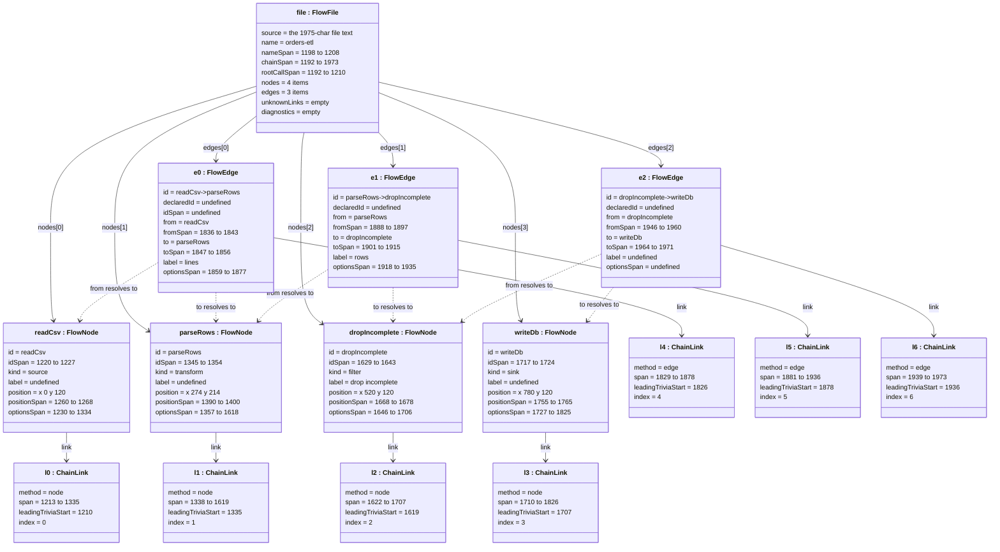
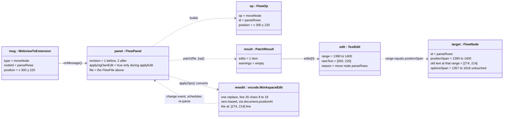
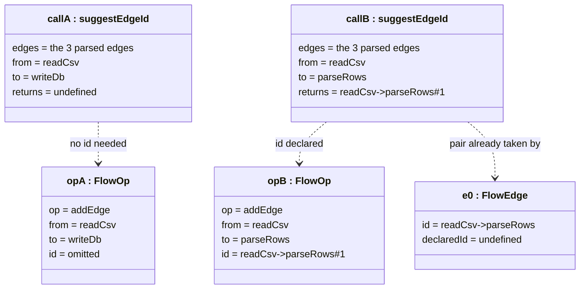
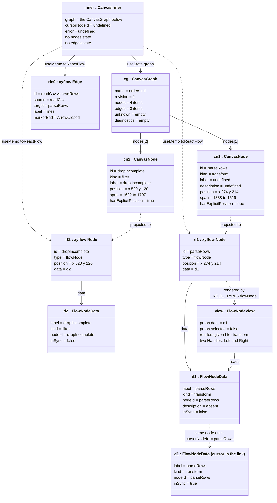
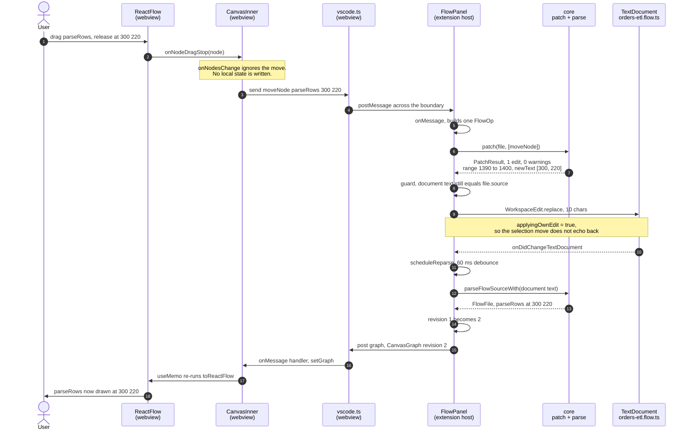

# twowayflow — UML object diagrams

```
┌─────────────────────────────────────────────────────────────────────────────────────────────┐
│ Name         uml-object-diagram                                                             │
│ Type         UML object diagram — instance snapshots with real runtime values               │
│ Project      twowayflow                                                                     │
│ Description  The object graph in memory after parsing examples/orders-etl.flow.ts, the      │
│              same graph two projections later inside the React webview, and one canvas      │
│              drag turning into one ranged text edit across both runtimes. Every attribute   │
│              value below was produced by running the real parser, patcher and canvas        │
│              projection, not written by hand.                                                │
└─────────────────────────────────────────────────────────────────────────────────────────────┘
```

> **Class diagram vs. object diagram.** A class diagram shows the *types* and holds for every
> run; that is [uml-class-diagram.md](uml-class-diagram.md). An object diagram shows *one
> snapshot of actual instances* with their actual attribute values. All five below are real: the
> values came out of `parseFlowSource()`, `patch()`, `suggestEdgeId()` and `toCanvasGraph()` on
> [examples/orders-etl.flow.ts](../../examples/orders-etl.flow.ts) (1975 characters), so they are
> reproducible rather than illustrative.
>
> §1–§3 are the extension host; §4 is the same data inside the webview; §5 is the drag crossing
> between them.

## 1. After parsing `orders-etl.flow.ts`



### What this snapshot shows that the class diagram cannot

- **The links tile the chain.** Each `ChainLink.leadingTriviaStart` equals the previous link's
  `span.end` — 1210/1335, 1335/1619, 1619/1707, 1707/1826, 1826/1878, 1878/1936, 1936/1973 —
  and the last `span.end` is `chainSpan.end`. That contiguity is the invariant
  `checkSpanInvariants()` exists to assert, and it is what makes deletion able to take its own
  newline and indentation with it and nothing else.
- **`parseRows.optionsSpan` is 261 characters** (1357→1618) for a node whose canvas-visible
  attributes are two words and a coordinate pair. The rest is the inline `run:` arrow function —
  opaque payload. A drag must leave all 261 bytes alone except the 10 inside `positionSpan`.
- **Edge identity is positional in all three cases.** `declaredId` is `undefined` throughout, so
  every `id` is the derived `from->to`. No pair repeats here, so no `#n` suffix appears and every
  identity is stable. `e2` additionally has no `label` and no `optionsSpan`, because
  `.edge("dropIncomplete", "writeDb")` was written without an options object at all.
- **Both failure lists are empty.** `unknownLinks` and `diagnostics` being empty is what makes
  this file fully projectable; a fixture like `unparsable-beside-valid.flow.ts` would populate the
  first, and the canvas would draw those links as opaque boxes.

## 2. One canvas drag: `moveNode` → a single `TextEdit`

The user drags `parseRows` from (274, 214) to (300, 220). This is the object graph that carries
that gesture from webview to disk — the real output of `patch()`.



**The whole drag is a 10-character replacement.** `range` is exactly
`parseRows.positionSpan` from the snapshot above, `[274, 214]` becomes `[300, 220]`, `warnings`
is empty, and the 261-byte `optionsSpan` containing the `run:` closure is never in any edit's
range. Nothing is reprinted, so VS Code sees an ordinary text edit and undo, git gutters and
dirty state all behave as they do for typing.

**The re-parse after the extension's own edit is deliberate, not suppressed.** `applyOps()`
calls `scheduleReparse()` explicitly on its last line, and `onDidChangeTextDocument` schedules one
too; the debounce collapses them into a single parse 60 ms later, which bumps `revision` to 2 and
posts a fresh graph. That is the whole design: the canvas never updates from its own gesture, it
updates from the file — so what the user sees after a drag has been through the parser.

`applyingOwnEdit` guards something narrower, in the *other* sync direction. Applying a
`WorkspaceEdit` moves the editor's selection, which fires `onDidChangeTextEditorSelection`;
without the flag, `revealFromCursor()` would read that as the user moving the cursor and post a
`reveal` back to the canvas. It is a selection-echo guard
([panel.ts:278](../../packages/vscode-ext/src/panel.ts#L278)), the only place it is read.

## 3. Edge identity under `suggestEdgeId` — two instance cases

`FlowPanel.onMessage` asks `suggestEdgeId()` whether a new edge needs a declared id. Both results
below are real calls against the parse in §1:



The first pair has no existing edge, so `from->to` already identifies it and no `id` is written —
keeping the authored file as clean as a hand-written one. The second pair is already occupied by
`e0`, so the canvas declares `readCsv->parseRows#1` on the new edge. That declaration is what
makes `e0`'s own positional identity safe: deleting the new edge cannot renumber it, because
`edgeIds()` counts only *undeclared* edges.

## 4. The webview, at the instant before the drag

The same four nodes again, two projections further on: `FlowFile` → `toCanvasGraph()` →
`CanvasGraph` → `toReactFlow()` → xyflow `Node` objects. Both projections were executed, so
every value below is output, not transcription (see [Reproducing](#reproducing-these-values)).



Three things this snapshot pins down:

- **`CanvasNode.span` is the whole `.node(...)` link, not the id.** `parseRows` carries
  1338→1619 here, where the `FlowNode` in §1 carried `idSpan` 1345→1354 and `positionSpan`
  1390→1400 separately. `toCanvasGraph` keeps only `node.link.span`, because the only thing the
  canvas does with a span is reveal the link in the editor. The fine-grained spans stay on the
  extension side, where patching happens.
- **Identity and label part company.** `d2.label` is `drop incomplete` while `rf2.id` is
  `dropIncomplete`. `toReactFlow` computes `node.label ?? node.id`, so a node with no `label`
  option displays its id — `d1.label` is `parseRows` for exactly that reason. Gestures carry
  `node.id`, never the displayed text.
- **`inner` has no node state at all.** `rf1`, `rf2` and `rfe` are not stored anywhere; they are
  the current value of a `useMemo` and are rebuilt whenever `graph` or `cursorNodeId` changes.
  There is no object in this diagram that could hold a position the file disagrees with. Running
  `toReactFlow` a second time with `cursorNodeId = "parseRows"` returns a wholly new array whose
  only difference is `inSync: true` on that one node (`d1` above becomes `d1b`) — the
  cursor-follows-canvas highlight is a re-projection, not a mutation.

With `hasExplicitPosition: true` on all four nodes, nothing here is auto-laid-out. Had a node
been written without `at:`, `toCanvasGraph` would have invented a position from `COLUMN_WIDTH`
and `ROW_HEIGHT` and flagged it `false` — a position the canvas shows but the file does not
contain, and which a drag then writes for the first time.

## 5. The full round trip, both runtimes

The drag from §2, as it actually crosses the process boundary. Real values throughout.



The node the user let go of at (300, 220) is drawn at (300, 220) only at the last step — after a
patch, a disk-level text edit, and a fresh parse. Between the release and that frame it is drawn
wherever the *previous* parse said, which is why `onNodesChange` discarding the move is not a bug
to be fixed later: it is the mechanism. A canvas that optimistically moved the node would be
holding a second model, and the first time a patch failed or a hand edit disagreed, the two would
drift — which is the exact failure the project exists to avoid.

Two guards on that path are worth naming, because both are places the loop could corrupt rather
than merely misdraw:

- **Re-parse before patching.** If a debounced parse is still pending when a gesture arrives,
  `applyOps()` parses first. Patching against stale offsets would not give a wrong answer, it
  would write bytes into the wrong place.
- **Text equality check.** `applyOps()` compares `document.getText()` to `file.source` and bails
  to a plain re-parse if they differ. The spans in a `TextEdit` are only meaningful against the
  text they were computed from.

## Reproducing these values

Both snapshots came from running the shipped code against the example:

```bash
pnpm install && pnpm test
```

The parse in §1 is `parseFlowSource(readFileSync("examples/orders-etl.flow.ts", "utf8"))`; the
patch in §2 is `patch(file, [{ op: "moveNode", id: "parseRows", position: { x: 300, y: 220 } }])`;
the two calls in §3 are `suggestEdgeId(file.edges, from, to)`; the canvas graph in §4 is
`toCanvasGraph(file, 1)`.

`toReactFlow` is module-private in `Canvas.tsx`, so it was executed without altering the file:
its source ([Canvas.tsx:22-59](../../packages/vscode-ext/webview/Canvas.tsx#L22-L59)) was sliced
out between the `function toReactFlow(` and `function CanvasInner(` markers, stripped of types
with the repo's own esbuild
(`esbuild --loader=ts --format=cjs`), and called with a `MarkerType` stub — the only runtime
value it closes over. Spans are UTF-16 code-unit indices
into `file.source`, so `sliceSpan(file.source, span)` reads back the text any box above refers to.
Editing the example file shifts every offset, which is the point: the numbers are a snapshot of
one file at one revision, not part of the model.
